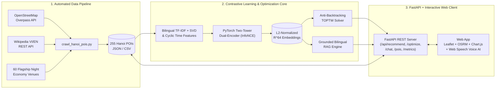

<div align="center">

# 🌙 Hanoi Night-Tourism AI

### Context-Aware Smart Tourism & Night Economy Platform Powered by Two-Tower Contrastive Learning, Anti-Backtracking TOPTW Routing & Voice-Enabled Grounded RAG

<p>
  <a href="https://github.com/nqming/hanoi-night-tourism-ai/actions/workflows/ci-cd.yml">
    
  </a>
  
  
  
  
  
  
</p>

<p>
  <a href="#-overview">Overview</a> •
  <a href="#-key-features">Key Features</a> •
  <a href="#%EF%B8%8F-system-architecture">Architecture</a> •
  <a href="#-methodology--math">Methodology</a> •
  <a href="#-benchmark-results">Benchmarks</a> •
  <a href="#-quick-start">Quick Start</a> •
  <a href="#-cicd--docker">CI/CD & Docker</a>
</p>

</div>

---

## 🎯 Overview

**Hanoi Night-Tourism AI** is an end-to-end, production-ready AI web platform built to address **Hanoi's Smart Tourism & Night Economy Challenge** (*Bài toán số 15: Phát triển du lịch thông minh và kinh tế đêm*) — supporting the capital's strategic goal of welcoming **12 million international visitors by 2030** by transforming fragmented night-time experiences into seamless, personalized, data-driven journeys.

Instead of relying on static top-10 lists or naive keyword search, the platform combines:
1. **Two-Tower Contrastive Learning (PyTorch Dual-Encoder)** trained with **Symmetric InfoNCE + Hard-Negative Mining** to map bilingual tourist intent and Hanoi destinations into a unified $\mathbb{R}^{64}$ hypersphere.
2. **Anti-Backtracking Time-Window Itinerary Optimizer (TOPTW)** handling overnight wrap-around schedules (`17:00 → 05:00 (+1)`) and exact permutation refinement so travelers never zig-zag or loop back to their starting point.
3. **Interactive Multi-Color Street Map (Leaflet + OpenStreetMap + OSRM)** with GPS geolocation, custom address geocoding, and **parallel lane offset rendering** so overlapping route legs appear cleanly side-by-side.
4. **Voice-Enabled Bilingual Grounded RAG Assistant** supporting real-time Vietnamese/English Speech-to-Text (`🎙️`) and Text-to-Speech (`🔊`) with strict category, post-midnight opening hour, and budget enforcement.

---

## ✨ Key Features

| Capability | Description |
| :--- | :--- |
| 🧠 **Two-Tower Contrastive Learning** | PyTorch Residual Dual-Encoder projecting bilingual queries + temporal/budget/weather context and POI embeddings into a shared L2-normalized space. Supports **Zero-Shot Cold-Start** encoding for newly added night events. |
| 🧭 **Anti-Backtracking TOPTW Solver** | Multi-objective Beam Search + Exact Permutation ($k!$) & 2-Opt refinement. Strictly respects opening hours (including past-midnight wrap-around `00:00–05:00`), budget caps, weather (indoor priority when raining), and start-proximity ordering. |
| 🎨 **Multi-Color Parallel Street Routing** | Every leg (`S → #1`, `#1 → #2`, ...) renders in a distinct high-contrast color along real Hanoi streets via **OSRM**. Overlapping road corridors are automatically shifted along the road's canonical normal vector into parallel lanes. |
| 📍 **Dynamic Start Location** | Supports **Browser GPS Geolocation** with automatic Nominatim reverse geocoding, **free-text Hanoi address search**, and **interactive map clicking / draggable `S` marker**. |
| 🎙️ **Voice-Enabled Grounded RAG** | Bilingual (VI/EN) semantic retrieval assistant with strict intent parsing (e.g., *"sau 0h đêm đi ăn gì với tài chính 50k"* → filters strictly to open `night_food` venues `≤ 50,000đ` after `00:00 (+1)`), plus Web Speech API Mic & TTS playback. |
| 🗺️ **255 Real Crawled Hanoi POIs** | Automated crawler aggregating **OpenStreetMap Overpass API** + **Wikipedia REST API** + curated flagship night tours (`228` Night Economy POIs across 6 central Hanoi districts) with live Admin CRUD. |
| 📊 **Evaluation & Analytics Dashboard** | Built-in interactive Chart.js analytics plotting InfoNCE training convergence, Benchmark comparisons (`NDCG@10`, `MRR`, `Recall@K`, `Cold-Start Hit@10`), and Before-vs-After route optimization gains. |

---

## 🏗️ System Architecture



---

## 🔬 Methodology & Math

### 1. Two-Tower Contrastive Learning (Dual-Encoder InfoNCE)

Given a batch of $B$ triplets $\{(\mathbf{x}_i^{\text{ctx}}, \mathbf{x}_i^{+}, \mathbf{x}_i^{-})\}_{i=1}^B$ where $\mathbf{x}_i^{-}$ is an explicit **Hard Negative** (a venue that closes before the requested night window, exceeds budget, mismatches category, or is outdoors during rain), the Context Tower $f_\theta$ and POI Tower $g_\phi$ output unit-norm embeddings $\mathbf{u}_i, \mathbf{v}_i^+, \mathbf{v}_i^- \in \mathbb{S}^{63}$.

We optimize a **Symmetric InfoNCE Loss** with learnable temperature $\tau$ plus an explicit **Hard-Negative Margin Penalty**:

$$\mathcal{L}_{\text{c2p}} = -\frac{1}{B}\sum_{i=1}^{B} \log \frac{\exp(\mathbf{u}_i^\top \mathbf{v}_i^+ / \tau)}{\sum_{j=1}^{B}\exp(\mathbf{u}_i^\top \mathbf{v}_j^+ / \tau) + \sum_{k=1}^{B}\exp(\mathbf{u}_i^\top \mathbf{v}_k^- / \tau)}$$

$$\mathcal{L}_{\text{total}} = 0.65\,\mathcal{L}_{\text{c2p}} + 0.35\,\mathcal{L}_{\text{p2c}} + \lambda \cdot \frac{1}{B}\sum_{i=1}^{B}\max\big(0,\, m - (\mathbf{u}_i^\top \mathbf{v}_i^+ - \mathbf{u}_i^\top \mathbf{v}_i^-)\big)$$

### 2. Anti-Backtracking Day-to-Night TOPTW Objective

Over the Top-$K$ Contrastive candidates, our solver finds an ordered itinerary $\mathcal{P} = (p_1, \dots, p_m)$ maximizing:

$$U(\mathcal{P}) = \sum_{p \in \mathcal{P}} \text{sim}(\mathbf{u}, \mathbf{v}_p) + \alpha\,\text{Diversity}(\mathcal{P}) + \beta\,\text{NightStops}(\mathcal{P}) + \gamma\,\mathbb{I}_{\text{near\_start}}(p_1) - \eta_1\,\text{Dist}(\mathcal{P}) - \eta_2\,\text{Wait}(\mathcal{P}) - \eta_3\,\text{Backtrack}(\mathcal{P})$$

subject to strict opening-hour feasibility across overnight windows ($t \in [6.0, 30.0]$ where $24.0 = 00\text{:}00\text{ (+1)}$) and total budget $\sum_{p \in \mathcal{P}} \text{cost}(p) \le B_{\max}$.

---

## 📊 Benchmark Results

Evaluated on a held-out test split of **300 unseen user-context queries** across **255 Hanoi POIs**, including **38 Zero-Shot Cold-Start POIs** never seen during training:

| Model | Recall@5 | Recall@10 | MRR | NDCG@10 | Constraint Sat. @5 | Cold-Start Hit@10 |
| :--- | :---: | :---: | :---: | :---: | :---: | :---: |
| Popularity Baseline | 0.1580 | 0.2353 | 0.2651 | 0.1901 | 71.6% | 26.3% |
| TF-IDF Content-Based | 0.1913 | 0.2993 | 0.4019 | 0.2591 | 82.6% | 40.0% |
| **Two-Tower Contrastive Learning (Ours)** | **0.5700** | **0.7873** | **0.8841** | **0.7417** | **93.5%** | **56.0%** |

> **Key Takeaway:** Compared to the TF-IDF Content-Based baseline, our Two-Tower Contrastive Learning model achieves **+186% relative gain in NDCG@10**, **+120% in MRR**, and **93.5% time-window & budget constraint satisfaction** in Top-5 results.

---

## 🚀 Quick Start

### Option 1: Docker Compose (Recommended — 1 Command)

```bash
git clone https://github.com/nqming/hanoi-night-tourism-ai.git
cd hanoi-night-tourism-ai
docker compose up -d --build
```

Open in your browser:
- **Web Application:** `http://localhost:8000`
- **Interactive Swagger API Docs:** `http://localhost:8000/docs`

### Option 2: Local Python Setup

```bash
git clone https://github.com/nqming/hanoi-night-tourism-ai.git
cd hanoi-night-tourism-ai

# Install dependencies
pip install -r requirements.txt

# (Optional) Re-crawl live Hanoi POIs from OpenStreetMap & Wikipedia
python data/crawl_hanoi_pois.py

# (Optional) Regenerate contrastive triplets & retrain PyTorch model
python data/generate_training_pairs.py
python ml/train.py

# Run full unit & integration test suite (9 tests)
python -m unittest discover -s tests -v

# Launch FastAPI + Frontend server
uvicorn backend.main:app --host 0.0.0.0 --port 8000 --reload
```

*(Optional)* Set `GEMINI_API_KEY` in your environment to enable Gemini LLM phrasing on top of the grounded Contrastive RAG retriever; without a key, the built-in local grounded RAG engine runs 100% free and offline.

---

## 🔌 REST API Reference

| Method | Endpoint | Description |
| :--- | :--- | :--- |
| `GET` | `/api/health` | Service healthcheck, POI count, and learned Contrastive temperature $\tau$ |
| `GET` | `/api/pois` | Query/filter 255+ Hanoi POIs by district, category, night-only, or keyword |
| `POST` | `/api/pois` | Add a new destination/night event + instant Zero-Shot Contrastive encoding |
| `PUT` / `DELETE` | `/api/pois/{id}` | Update or remove a POI and sync the vector index |
| `POST` | `/api/recommend` | Two-Tower Contrastive Learning ranked POI recommendations |
| `POST` | `/api/optimize-itinerary` | Anti-backtracking TOPTW Day-to-Night itinerary + Naive Baseline comparison |
| `POST` | `/api/chat` | Grounded Bilingual (VI/EN) RAG Assistant with strict time/budget/category parsing |
| `GET` | `/api/metrics` | Full Contrastive Learning benchmark metrics, training curves & dataset stats |

<details>
<summary><b>Example: Post-Midnight 50k Street Food RAG Query (curl)</b></summary>

```bash
curl -X POST http://localhost:8000/api/chat \
  -H "Content-Type: application/json" \
  -d '{"message": "Sau 0h đêm thì đi ăn gì với tài chính 50k?"}'
```

</details>

---

## ⚙️ CI/CD & Docker

The repository ships with a complete production **GitHub Actions CI/CD pipeline** (`.github/workflows/ci-cd.yml`) triggered on every push and pull request:

1. **Lint & Test (`lint-and-test`)**: Runs `ruff` static analysis, executes all `pytest` unit & FastAPI integration tests, and enforces a strict **ML Quality Gate** (`NDCG@10 > 0.65`).
2. **Docker Build & Live Smoke Test (`docker-build-and-smoke-test`)**: Builds the non-root `python:3.12-slim` + CPU PyTorch image via Buildx cache, spins up a real container, and validates live HTTP responses from `/api/health`, `/api/recommend`, and `/api/optimize-itinerary`.
3. **Automated Registry Publishing (`ghcr.io`)**: Automatically tags (`latest`, `sha-<commit>`, `v*`) and pushes verified images to **GitHub Container Registry** (`ghcr.io/nqming/hanoi-night-tourism-ai:latest`).

---

## 📂 Project Structure

```text
hanoi-night-tourism-ai/
├── .github/workflows/ci-cd.yml     # Automated CI/CD: Lint -> Test -> Build -> Smoke Test -> GHCR Push
├── Dockerfile                      # Production container (Python 3.12 + CPU PyTorch + non-root + healthcheck)
├── docker-compose.yml              # One-command deployment with persistent POI volume
├── data/
│   ├── curated_hanoi_night.py      # 60 curated flagship Hanoi Night Economy venues
│   ├── crawl_hanoi_pois.py         # Automated OpenStreetMap Overpass + Wikipedia crawler
│   ├── generate_training_pairs.py  # Bilingual Positive & Hard-Negative triplet generator
│   └── processed/                  # hanoi_pois.json (255 POIs), hanoi_pois.csv, training_pairs.json
├── ml/
│   ├── features.py                 # Bilingual TF-IDF + SVD + cyclic temporal & structured encoders
│   ├── model.py                    # PyTorch Two-Tower Contrastive Net (InfoNCE + Hard-Negative Margin)
│   ├── train.py                    # End-to-end training & 3-way benchmark evaluator
│   ├── inference.py                # Thread-safe retrieval engine with Zero-Shot POI hot-encoding
│   ├── optimizer.py                # Anti-backtracking TOPTW solver & Naive Baseline comparator
│   ├── rag_assistant.py            # Grounded VI/EN RAG engine with strict midnight/budget/category parsing
│   └── checkpoints/                # Trained weights, feature extractor, embeddings & metrics.json
├── backend/                        # FastAPI app, Pydantic v2 schemas, thread-safe POI CRUD storage
├── frontend/                       # Tailwind UI, Leaflet + OSRM multi-color parallel legs, Web Speech Voice AI
└── tests/test_suite.py             # 9 automated unit & FastAPI integration tests
```

---

## 👨‍💻 Author & Academic Attribution

- **Author:** Nguyễn Quang Minh ([@nqming](https://github.com/nqming))
- **Class / Student ID:** `65TTNT` — `2351260672`
- **Research Topic:** *Bài toán số 15 — Phát triển du lịch thông minh và kinh tế đêm tại Hà Nội* (Smart Tourism & Night Economy Development in Hanoi)

<div align="center">
  <sub>If you find this project useful for smart-city tourism, contrastive recommendation, or TOPTW itinerary optimization, consider giving it a ⭐ on GitHub!</sub>
</div>
