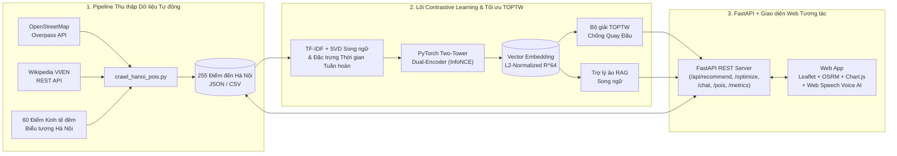

<div align="center">

# 🌙 Hanoi Night-Tourism AI

### Nền tảng Du lịch Thông minh & Kinh tế Đêm Hà Nội ứng dụng Two-Tower Contrastive Learning, Tối ưu hóa Lộ trình TOPTW Chống Quay Đầu & Trợ lý ảo RAG Giọng nói

<p>
  <a href="https://github.com/nqming/hanoi-night-tourism-ai/actions/workflows/ci-cd.yml">
    
  </a>
  
  
  
  
  
  
</p>

<p>
  <a href="README.md">🇬🇧 English</a> &nbsp;|&nbsp; <strong>🇻🇳 Tiếng Việt</strong>
</p>

<p>
  <a href="#-tổng-quan">Tổng quan</a> •
  <a href="#-tính-năng-nổi-bật">Tính năng</a> •
  <a href="#%EF%B8%8F-kiến-trúc-hệ-thống">Kiến trúc</a> •
  <a href="#-phương-pháp--công-thức">Phương pháp</a> •
  <a href="#-kết-quả-thực-nghiệm">Benchmark</a> •
  <a href="#-khởi-chạy-nhanh">Khởi chạy nhanh</a> •
  <a href="#-cicd--docker">CI/CD & Docker</a>
</p>

</div>

---

## 🎯 Tổng quan

**Hanoi Night-Tourism AI** là nền tảng web du lịch thông minh hoàn chỉnh được xây dựng nhằm giải quyết **Bài toán số 15: Phát triển du lịch thông minh và kinh tế đêm tại Hà Nội** — hướng tới mục tiêu đón **12 triệu lượt khách quốc tế vào năm 2030** thông qua việc số hóa đồng bộ hệ sinh thái dịch vụ đêm và cá nhân hóa trải nghiệm du khách.

Thay vì các danh sách gợi ý tĩnh hay tìm kiếm từ khóa rời rạc, hệ thống kết hợp 4 trụ cột công nghệ:
1. **Mô hình Two-Tower Contrastive Learning (PyTorch Dual-Encoder)** huấn luyện bằng hàm mất mát **Symmetric InfoNCE kết hợp Hard-Negative Mining**, ánh xạ nhu cầu du khách và điểm đến Hà Nội vào cùng không gian vector $\mathbb{R}^{64}$.
2. **Thuật toán Tối ưu Lộ trình có Khung thời gian Chống Quay Đầu (TOPTW)** hỗ trợ khung giờ xuyên đêm (`17:00 → 05:00 (+1)`) và duyệt hoán vị tối ưu để du khách luôn trải nghiệm điểm gần vị trí xuất phát trước, không đi vòng ngược lại.
3. **Bản đồ số Đa màu Tách làn Song song (Leaflet + OpenStreetMap + OSRM)** tích hợp định vị GPS thực tế, tìm kiếm địa chỉ tự do và tự động tách làn song song khi các chặng đường trùng nhau.
4. **Trợ lý ảo RAG Song ngữ tích hợp Giọng nói (Web Speech API)** hỗ trợ nói (`🎙️`) và nghe (`🔊`) trực tiếp bằng Tiếng Việt/Tiếng Anh với cơ chế lọc cứng theo loại hình, giờ mở cửa sau 0h và ngân sách.

---

## ✨ Tính năng nổi bật

| Tính năng | Mô tả chi tiết |
| :--- | :--- |
| 🧠 **Two-Tower Contrastive Learning** | Kiến trúc Residual Dual-Encoder bằng PyTorch chiếu truy vấn song ngữ + ngữ cảnh (giờ, ngân sách, thời tiết) và đặc trưng điểm đến vào không gian L2-normalized. Hỗ trợ **Zero-Shot Cold-Start** cho sự kiện đêm mới thêm vào. |
| 🧭 **Bộ giải TOPTW Chống Quay Đầu** | Beam Search đa mục tiêu + duyệt hoán vị chính xác ($k!$) & 2-Opt. Tuân thủ nghiêm ngặt giờ mở cửa qua nửa đêm (`00:00–05:00`), ngân sách, thời tiết (ưu tiên trong nhà khi trời mưa) và thứ tự khoảng cách từ điểm xuất phát. |
| 🎨 **Định tuyến Đa màu Tách làn Song song** | Mỗi chặng (`S → #1`, `#1 → #2`, ...) hiển thị bằng một màu riêng biệt theo tuyến phố thực tế qua **OSRM**. Các đoạn trùng hành lang đường tự động dịch chuyển theo vector pháp tuyến để nằm song song cạnh nhau, không đè khuất nhau. |
| 📍 **Điểm xuất phát Linh hoạt** | Hỗ trợ **Định vị GPS trình duyệt** (kèm giải mã địa chỉ Nominatim), **tự nhập địa chỉ bất kỳ tại Hà Nội**, và **chấm trực tiếp / kéo thả điểm `S`** trên bản đồ. |
| 🎙️ **Trợ lý ảo RAG & Giọng nói Song ngữ** | Truy xuất ngữ nghĩa trực tiếp từ không gian vector Contrastive Learning với bộ lọc chặt theo ý định (VD: *"Sau 0h đêm đi ăn gì với tài chính 50k?"* → chỉ trả về quán ăn `night_food` mở sau `00:00 (+1)` giá `≤ 50.000đ`), kèm Mic & Loa đọc tự động. |
| 🗺️ **255 Điểm đến Thực tế tại Hà Nội** | Crawler tự động tổng hợp từ **OpenStreetMap Overpass API** + **Wikipedia REST API** + 60 điểm kinh tế đêm biểu tượng (**228 điểm Kinh tế đêm** tại 6 quận trung tâm), hỗ trợ Admin CRUD trực tiếp trên Web. |
| 📊 **Dashboard Đánh giá & Thống kê** | Trực quan hóa bằng Chart.js: đường cong hội tụ InfoNCE Loss, biểu đồ so sánh Benchmark (`NDCG@10`, `MRR`, `Recall@K`, `Cold-Start Hit@10`) và bảng so sánh Trước & Sau tối ưu lộ trình. |

---

## 🏗️ Kiến trúc hệ thống



---

## 🔬 Phương pháp & Công thức

### 1. Học tương phản Hai nhánh (Two-Tower Contrastive Learning)

Với mỗi batch gồm $B$ bộ ba $`\{(\mathbf{x}_i^{\text{ctx}}, \mathbf{x}_i^{+}, \mathbf{x}_i^{-})\}_{i=1}^B`$, trong đó $`\mathbf{x}_i^{-}`$ là mẫu **Hard Negative** (điểm đóng cửa trước khung giờ đêm yêu cầu, vượt ngân sách, sai loại hình hoặc ngoài trời khi trời mưa), hai nhánh Context Tower $`f_\theta`$ và POI Tower $`g_\phi`$ tạo ra các vector chuẩn hóa đơn vị $`\mathbf{u}_i, \mathbf{v}_i^+, \mathbf{v}_i^- \in \mathbb{S}^{63}`$.

Mô hình tối ưu hàm mất mát **Symmetric InfoNCE** (với nhiệt độ học được $\tau$) kết hợp **Hard-Negative Margin Penalty**:

$$
\mathcal{L}_{\text{c2p}} = -\frac{1}{B}\sum_{i=1}^{B} \log \frac{\exp(\mathbf{u}_i^\top \mathbf{v}_i^+ / \tau)}{\sum_{j=1}^{B}\exp(\mathbf{u}_i^\top \mathbf{v}_j^+ / \tau) + \sum_{k=1}^{B}\exp(\mathbf{u}_i^\top \mathbf{v}_k^- / \tau)}
$$

$$
\mathcal{L}_{\text{total}} = 0.65\,\mathcal{L}_{\text{c2p}} + 0.35\,\mathcal{L}_{\text{p2c}} + \lambda \cdot \frac{1}{B}\sum_{i=1}^{B}\max\big(0,\, m - (\mathbf{u}_i^\top \mathbf{v}_i^+ - \mathbf{u}_i^\top \mathbf{v}_i^-)\big)
$$

### 2. Hàm mục tiêu Tối ưu Lộ trình Ngày – Đêm (TOPTW)

Trên tập Top-K ứng viên từ Contrastive Learning, bộ giải tìm hành trình có thứ tự $\mathcal{P} = (p_1, \dots, p_m)$ tối đa hóa:

$$
U(\mathcal{P}) = \sum_{p \in \mathcal{P}} \text{sim}(\mathbf{u}, \mathbf{v}_p) + \alpha\,\text{Diversity}(\mathcal{P}) + \beta\,\text{NightStops}(\mathcal{P}) + \gamma\,\mathbb{I}_{\text{near-start}}(p_1) - \eta_1\,\text{Dist}(\mathcal{P}) - \eta_2\,\text{Wait}(\mathcal{P}) - \eta_3\,\text{Backtrack}(\mathcal{P})
$$

thỏa mãn chặt chẽ khung giờ mở cửa xuyên đêm ($t \in [6.0, 30.0]$ với $24.0 = 00\text{:}00\text{ (+1)}$) và tổng ngân sách $\sum_{p \in \mathcal{P}} \text{cost}(p) \le B_{\max}$.

---

## 📊 Kết quả Thực nghiệm

Đánh giá trên tập kiểm thử độc lập gồm **300 truy vấn ngữ cảnh chưa từng thấy** trên toàn bộ **255 điểm đến Hà Nội**, bao gồm **38 điểm Zero-Shot Cold-Start** chưa từng xuất hiện trong tập huấn luyện:

| Mô hình | Recall@5 | Recall@10 | MRR | NDCG@10 | Thỏa mãn Giờ & Giá @5 | Cold-Start Hit@10 |
| :--- | :---: | :---: | :---: | :---: | :---: | :---: |
| Popularity Baseline | 0.1580 | 0.2353 | 0.2651 | 0.1901 | 71.6% | 26.3% |
| TF-IDF Content-Based | 0.1913 | 0.2993 | 0.4019 | 0.2591 | 82.6% | 40.0% |
| **Two-Tower Contrastive Learning (Ours)** | **0.5700** | **0.7873** | **0.8841** | **0.7417** | **93.5%** | **56.0%** |

> **Nhận xét:** So với phương pháp Content-Based (TF-IDF), mô hình Two-Tower Contrastive Learning cải thiện **+186% chỉ số NDCG@10**, **+120% MRR**, và đạt tỷ lệ **93.5% thỏa mãn đồng thời khung giờ mở cửa & ngân sách** trong Top-5 kết quả.

---

## 🚀 Khởi chạy nhanh

### Cách 1: Dùng Docker Compose (Khuyên dùng)

```bash
git clone https://github.com/nqming/hanoi-night-tourism-ai.git
cd hanoi-night-tourism-ai
docker compose up -d --build
```

Mở trình duyệt truy cập:
- **Giao diện ứng dụng:** `http://localhost:8000`
- **Tài liệu API (Swagger UI):** `http://localhost:8000/docs`

### Cách 2: Chạy trực tiếp bằng Python Local

```bash
git clone https://github.com/nqming/hanoi-night-tourism-ai.git
cd hanoi-night-tourism-ai

# Cài đặt thư viện
pip install -r requirements.txt

# (Tùy chọn) Chạy lại crawler lấy dữ liệu mới từ OpenStreetMap & Wikipedia
python data/crawl_hanoi_pois.py

# (Tùy chọn) Sinh lại dữ liệu và huấn luyện lại mô hình PyTorch
python data/generate_training_pairs.py
python ml/train.py

# Chạy bộ kiểm thử tự động (9 test cases)
python -m unittest discover -s tests -v

# Khởi chạy FastAPI + Web App
uvicorn backend.main:app --host 0.0.0.0 --port 8000 --reload
```

*(Tùy chọn)* Thiết lập biến môi trường `GEMINI_API_KEY` nếu muốn kết hợp Gemini LLM diễn đạt câu trả lời cho trợ lý ảo; nếu không cấu hình, hệ thống mặc định chạy **100% miễn phí và ổn định** bằng bộ sinh câu trả lời Grounded RAG tích hợp sẵn.

---

## 🔌 Danh sách REST API

| Phương thức | Endpoint | Chức năng |
| :--- | :--- | :--- |
| `GET` | `/api/health` | Kiểm tra trạng thái hệ thống, số lượng POI và nhiệt độ $\tau$ của mô hình |
| `GET` | `/api/pois` | Tra cứu, lọc 255+ điểm đến Hà Nội theo quận, danh mục, kinh tế đêm, từ khóa |
| `POST` | `/api/pois` | Thêm điểm đến / sự kiện đêm mới + mã hóa Zero-Shot Contrastive tức thì |
| `PUT` / `DELETE` | `/api/pois/{id}` | Cập nhật hoặc xóa điểm đến và đồng bộ không gian vector AI |
| `POST` | `/api/recommend` | Gợi ý xếp hạng điểm đến bằng Two-Tower Contrastive Learning |
| `POST` | `/api/optimize-itinerary` | Tối ưu lộ trình Ngày – Đêm TOPTW chống quay đầu & so sánh với Baseline |
| `POST` | `/api/chat` | Trợ lý ảo RAG song ngữ (VI/EN) lọc chặt khung giờ sau 0h, loại hình & tài chính |
| `GET` | `/api/metrics` | Trả về đầy đủ chỉ số Benchmark, lịch sử huấn luyện & thống kê dữ liệu |

---

## ⚙️ CI/CD & Docker

Dự án tích hợp sẵn pipeline **GitHub Actions CI/CD** tại `.github/workflows/ci-cd.yml` tự động chạy mỗi khi push code hoặc tạo Pull Request:

1. **Lint & Test (`lint-and-test`):** Kiểm tra mã nguồn bằng `ruff`, chạy toàn bộ `pytest` unit/integration tests và kiểm tra ngưỡng chất lượng mô hình (**ML Quality Gate: `NDCG@10 > 0.65`**).
2. **Docker Build & Smoke Test (`docker-build-and-smoke-test`):** Build image `python:3.12-slim` + CPU PyTorch (chạy user `non-root` kèm `HEALTHCHECK`), khởi chạy container thật trên CI và kiểm tra live các API `/api/health`, `/api/recommend`, `/api/optimize-itinerary`.
3. **Tự động phát hành Image (`ghcr.io`):** Tự động gắn tag (`latest`, `sha-<commit>`, `v*`) và đẩy Docker image lên **GitHub Container Registry** (`ghcr.io/nqming/hanoi-night-tourism-ai:latest`).

---

## 👨‍💻 Tác giả & Thông tin Học thuật

- **Tác giả:** Nguyễn Quang Minh ([@nqming](https://github.com/nqming))
- **Đề tài nghiên cứu:** *Bài toán số 15 — Phát triển du lịch thông minh và kinh tế đêm tại Hà Nội*

